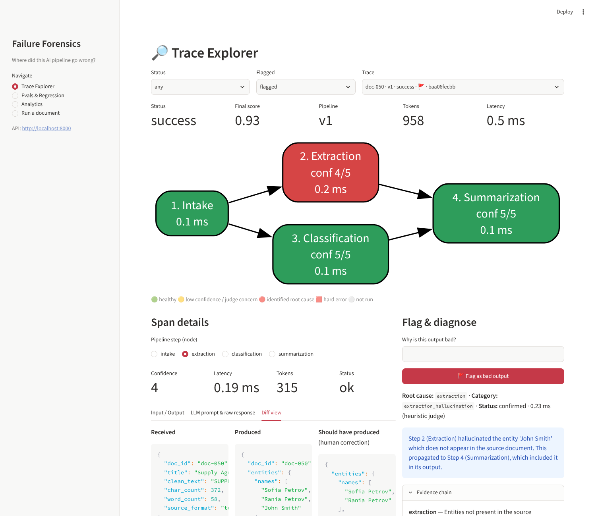
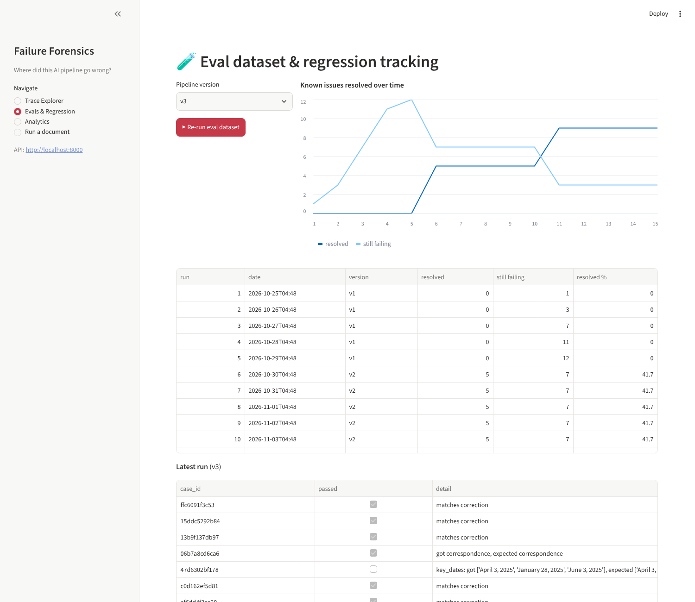
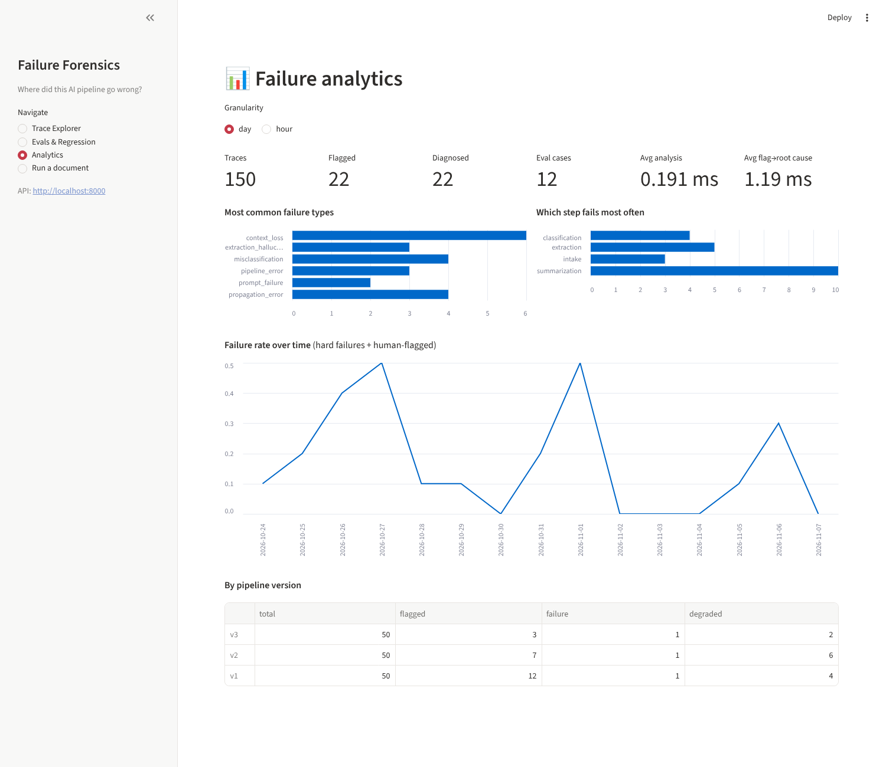

# 🔎 AI Failure Forensics

**When a multi-step AI pipeline produces garbage, which step broke?**

This is an observability layer for LLM pipelines, a mini LangSmith/Braintrust. It:

* **traces** every intermediate step with OpenTelemetry and custom spans (input, output, prompt, raw response, tokens, latency, self-rated confidence),
* **diagnoses** bad outputs by walking the trace backward with step-level judges, then names the root-cause step, the failure category and an evidence chain,
* **learns** from human feedback: every confirmed diagnosis becomes an eval case, and regression runs track known issues being resolved across prompt versions.

> **Result:** mean time to root cause drops from hours of manual prompt-by-prompt debugging to **under a millisecond** of automated diagnosis (seconds with an LLM judge).



*The trace above passed every automatic check (status `success`, extraction confidence 4/5), yet a human flagged it. The analyzer pins the cause on **Step 2 (Extraction)**, which hallucinated the signatory "John Smith" from a blank signature line, and shows that the error propagated into the summary.*

---

## Quick start (Docker)

```bash
git clone https://github.com/hmoubarak72/ai-failure-forensics.git
cd ai-failure-forensics
cp .env.example .env            # optional: add OPENAI_API_KEY; leave empty for offline mode
docker compose up --build
```

| Service | URL |
|---|---|
| Trace explorer (Streamlit) | http://localhost:8501 |
| REST API + Swagger docs | http://localhost:8000/docs |

On first start, the API seeds the demo scenario automatically: 50 documents × 3 prompt versions, human flags, diagnoses, eval cases and regression runs.

**No API key needed.** Without `OPENAI_API_KEY` the system uses a deterministic mock LLM that sees only the prompt (like a real model) and reproduces real failure modes, so the demo is fully reproducible. Add a key and the same pipeline runs on OpenAI, with LLM-as-judge diagnosis.

## Local development

```bash
python -m venv .venv && source .venv/bin/activate
make install          # deps + editable install
make test             # 14 tests: tracing, every failure category, API loop, prompt-version fixes
make demo             # build the demo scenario in ./data
make api              # terminal 1: http://localhost:8000
make ui               # terminal 2: http://localhost:8501
```

CLI: `forensics seed | run --version v2 | demo | analyze <trace_id> | evals --version v3 | serve`

## What's inside

| Layer | Implementation |
|---|---|
| Pipeline | 4 isolated steps (Intake → Extraction → Classification → Summarization), typed Pydantic I/O, versioned prompts (v1/v2/v3) |
| LLM | OpenAI (JSON mode) or deterministic `MockLLM` |
| Tracing | `@traced_step` decorator (one line per step) + OpenTelemetry spans, optional OTLP export |
| Storage | JSON trace files + SQLite index + append-only `eval_dataset.jsonl` |
| Analysis | Backward walk, heuristic and LLM-as-judge (hybrid), 5-category taxonomy + hard errors, evidence chains |
| UI | Streamlit: color-coded pipeline graph, span inspector, received/produced/expected diff, flag → confirm/override |
| Feedback | REST API: flag, confirm, eval cases, regression runs, analytics |
| Packaging | Multi-stage Dockerfile (non-root, healthcheck, volume), docker compose, GitHub Actions CI |

### Failure taxonomy

| Category | Example from the demo corpus |
|---|---|
| Extraction hallucination | Contract with no dates → the model invents "January 1, 2024"; blank signature → "John Smith" |
| Prompt failure | Mixed EUR/GBP invoice → every amount relabeled with one currency, despite the instruction |
| Misclassification | Cover letter full of invoice vocabulary → classified `invoice` (it's `correspondence`) |
| Propagation error | Extraction correctly reads $1,500,000; the summary reports USD 1,500.00 |
| Context loss | Long invoice: the summary keeps only the first 3 of 5 amounts |

### Demo results

```
[v1] 50 docs | flagged 12 | new eval cases 12
[v2] 50 docs | flagged 7
[v3] 50 docs | flagged 3

Regression trend (known issues resolved):  v1 0/12 → v2 5/12 (42%) → v3 9/12 (75%)
```

| Evals & regression | Failure analytics |
|---|---|
|  |  |

## REST API

| Method | Path | Purpose |
|---|---|---|
| POST | `/pipeline/run` · `/pipeline/batch` | run documents through the pipeline (choose `pipeline_version`) |
| GET | `/traces` · `/traces/{id}` | list (filter by status/flagged) and inspect traces |
| POST | `/traces/{id}/flag` | mark as bad output → runs backward root-cause analysis |
| POST | `/traces/{id}/confirm` | confirm or override the diagnosis → creates an eval case |
| GET | `/traces/{id}/diff/{step}` | received vs produced vs expected for one step |
| POST/GET | `/evals/run` · `/evals/runs` · `/evals/cases` | regression tracking |
| GET | `/analytics` | failure types, failing steps, failure rate over time, time to root cause |

## Configuration

| Variable | Default | Meaning |
|---|---|---|
| `OPENAI_API_KEY` | – | enables OpenAI for the pipeline and LLM-as-judge |
| `OPENAI_MODEL` | `gpt-4o-mini` | model name |
| `LLM_PROVIDER` | `auto` | `auto` / `openai` / `mock` |
| `JUDGE_PROVIDER` | `auto` | `auto` / `llm` / `heuristic` |
| `PIPELINE_VERSION` | `v1` | default prompt version |
| `FORENSICS_SEED_DEMO` | `1` | seed the demo on an empty data volume |
| `OTEL_EXPORTER_OTLP_ENDPOINT` | – | export spans to an OTLP collector |

See **[docs/ARCHITECTURE.md](docs/ARCHITECTURE.md)** for diagrams of the tracing layer, the backward analysis flow and the feedback loop.

## Recording the demo (Loom script)

1. Open **Analytics**: 150 traces, the most common failure types, and summarization as the weakest step.
2. In **Trace Explorer**, filter to *flagged* and open `doc-050 · v1`. The status reads `success`, but the summary names "John Smith".
3. Click the red **Extraction** node and open **Diff view**: produced vs expected names.
4. Read the diagnosis and its evidence chain, then **Confirm → add to eval dataset**.
5. In **Evals & Regression**, re-run on `v3` and watch the resolved line climb while context loss stays open as the next investment.

---
Built by Hesham Moubarak as part of an AI-engineering portfolio. MIT License.
