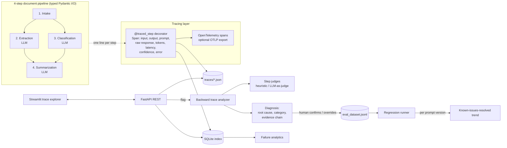
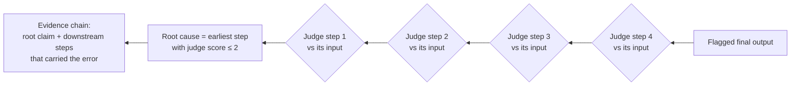

# Architecture

> **I built an observability system that reduces mean time to root cause for AI pipeline failures from hours of manual debugging to seconds of automated diagnosis.**
> In the demo, the backward analyzer diagnoses a flagged trace in well under 1 ms (heuristic judge) and in a few seconds with an LLM judge, versus the manual alternative of reading four prompts, four raw responses and the source document side by side.

## 1. System overview

## 2. The pipeline (Phase 1)

| Step | Input → Output | What can go wrong |
|---|---|---|
| Intake | `RawDocument` → `IntakeOutput` | empty / unreadable document (hard error) |
| Extraction | `IntakeOutput` → `ExtractionOutput` | hallucinated names/dates, ignored currency instruction |
| Classification | `IntakeOutput` → `ClassificationOutput` | ambiguous documents misclassified |
| Summarization | `StepInput(intake, extraction, classification)` → `SummarizationOutput` | misreads upstream values (propagation), drops facts (context loss) |

Every step is an isolated function with typed Pydantic input and output. Every LLM step asks the model to return a self-rated `confidence` (1–5), which is stored on the span.

**LLM providers.** `OpenAIClient` (JSON mode) is used when `OPENAI_API_KEY` is set. Otherwise `MockLLM`, a deterministic offline model, is used. It sees only the prompt text, just as a real model does, and reproduces five realistic failure behaviors. Each behavior stops when a specific rule is added to the prompt in a later prompt version. That makes regression tracking meaningful and reproducible in CI.

## 3. Tracing (Phase 2)

* `Tracer.trace()` opens a root OpenTelemetry span. Its 128-bit trace id becomes the `trace_id`.
* `@traced_step("extraction")` is the whole instrumentation cost per step. It records the serialized typed input and output, latency, errors and self-reported confidence. It also opens a child OTel span with the same data as attributes.
* LLM clients call `record_llm_call()`, which attaches prompt, raw response, token counts and latency to the active span through a `contextvar`, so nothing has to be passed around explicitly.
* Automatic checks set the trace status: `failure` (exception), `degraded` (low confidence or a broken invariant) or `success`. `final_score` is the mean normalized confidence.
* Storage: `data/traces/<trace_id>.json` (human-readable, git-friendly) plus `forensics.db`, a SQLite index with status, score, version, tokens, latency and flag metadata.
* Set `OTEL_EXPORTER_OTLP_ENDPOINT` to stream the same spans to Jaeger, Tempo or Honeycomb.

## 4. Backward trace analysis (Phase 3)

Each step is judged **only on its own transformation**. If a summary repeats a hallucination it received, the summary is not at fault, but it is listed as an affected downstream step.

| Category | Detection (heuristic judge) |
|---|---|
| Extraction hallucination | extracted entity not present verbatim in the source |
| Prompt failure | output violates an explicit instruction (for example, currency relabeled) |
| Misclassification | type disagrees with the golden label or a primary-purpose reading |
| Propagation error | step's input was correct, but its output misstates it (for example, 1,500,000 → 1,500) |
| Context loss | facts present in the step's input are missing from its output |
| Pipeline error | hard exception (outside the LLM-quality taxonomy) |

If no step scores ≤ 2, the lowest self-confidence span is reported as the primary suspect.

**LLM-as-judge.** With OpenAI configured, `LLMJudge` scores each step with `JUDGE_PROMPT`. It is hybridized with the deterministic checks: the lower score wins, so a lenient LLM judgment can never override a hard grounding fact.

## 5. Trace explorer (Phase 4)

Streamlit, talking only to the REST API:

* **Pipeline graph.** Each step is a node, colored green (healthy), yellow (low confidence or judge concern), red (root cause) or dark red (hard error).
* **Span details.** Selecting a node shows its input, output, prompt, raw response, tokens, latency and confidence.
* **Diff view.** Shows what the step received, what it produced, and what it should have produced (from a human correction or the golden dataset), with highlighted divergence.
* **Flag button.** Runs the analysis and shows the diagnosis with its evidence chain. The reviewer can confirm it or override the step and category, and edit the corrected output.

## 6. Feedback-to-eval loop (Phase 5)

1. **Flag.** `POST /traces/{id}/flag` runs the analysis and stores the diagnosis.
2. **Confirm or override.** `POST /traces/{id}/confirm` creates an `EvalCase` holding the original input, failing step, bad output, corrected output and category. It is appended to `eval_dataset.jsonl` and indexed in SQLite.
3. **Regression.** `POST /evals/run?pipeline_version=vN` re-runs every case and compares the failing step's new output with the correction, field by field.
4. **Analytics.** `GET /analytics` reports the most common failure types, the step that fails most often, failure rate over time, results by version, average time to root cause, and the regression trend.

### Demo result (`forensics demo`, 50 documents × 3 prompt versions over 15 simulated days)

| Version | What changed | Known issues resolved |
|---|---|---|
| v1 | baseline | 0 / 12 |
| v2 | grounding rule + per-amount currency rule | 5 / 12 (42%) |
| v3 | primary-purpose classification rule + copy-amounts rule | 9 / 12 (75%) |

The remaining open issues are context loss on long invoices, which no prompt version fixes yet, and the unreadable scanned page. That is exactly the "where to invest engineering effort next" signal the analytics page is built to surface.

## 7. Deployment

One image, three roles (`api`, `ui`, `demo`), selected by `docker/entrypoint.sh`:

* `docker compose up` starts the API on :8000 (it seeds the demo on an empty volume) and the UI on :8501. The UI waits for the API's healthcheck.
* The image is multi-stage, so wheels are built once and runtime layers stay slim. It runs as a non-root user, with a `HEALTHCHECK` and a persistent `/app/data` volume.
* CI runs pytest, builds the image and smoke-tests `/health` and `/analytics` in the container.
